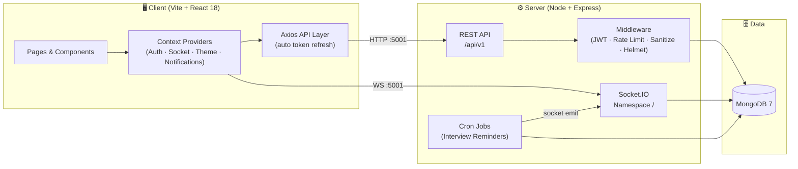
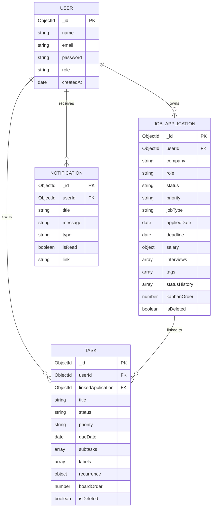
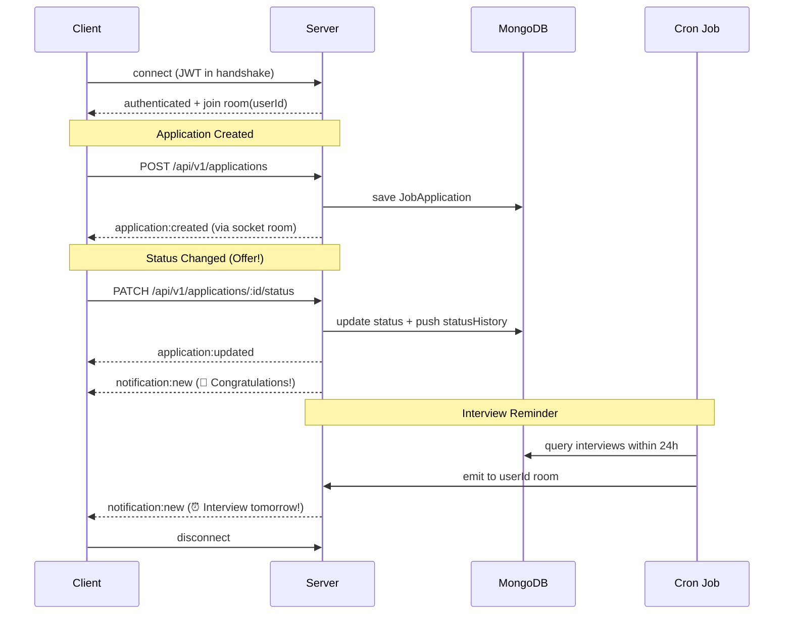

<div align="center">


<h1>TaskFlow</h1>

<p><strong>A production-quality full-stack Job Application Tracker + Task Manager</strong><br/>
Built with real-time updates, smart Kanban boards, and a command palette.</p>

[](https://reactjs.org)
[](https://nodejs.org)
[](https://mongodb.com)
[](https://socket.io)
[](https://docker.com)
[](https://vitejs.dev)
[](#-testing)
[](LICENSE)

[**Live Demo**](#-quick-start) · [**API Docs**](#-api-reference) · [**Screenshots**](#-screenshots) · [**Docker**](#-docker-one-command-startup)

</div>

---

## 📸 Screenshots

| Dashboard | Applications (Kanban) | Tasks (Board) |
|:---------:|:--------------------:|:-------------:|
| *(Analytics + stat cards + recent activity)* | *(Drag-and-drop Kanban with 5 columns)* | *(Board view with subtasks)* |

| Calendar | Command Palette | Dark Mode |
|:--------:|:---------------:|:---------:|
| *(react-big-calendar view of deadlines)* | *(⌘K spotlight search)* | *(full dark theme via CSS variables)* |

---

## ✨ Feature Highlights

- 🎯 **Job Application Kanban** — 5-column board (Wishlist → Applied → Interview → Offer → Rejected) with drag-and-drop reorder
- ✅ **Task Manager** — subtasks, labels, recurrence, priority levels, board + list views
- 📊 **Analytics Dashboard** — Recharts bar/pie/line charts, success rate, timeline heatmap
- 🔔 **Real-time Notifications** — Socket.IO push events, cron-based interview reminders
- 🔍 **Command Palette** — ⌘K spotlight, keyboard navigation (N · A · 1–5 · Esc)
- 🗑️ **Soft Delete + Undo** — 5-second undo toast on every delete
- 📅 **Calendar View** — unified deadline + interview calendar
- 🌙 **Dark / Light Mode** — full CSS variable theming
- 📱 **Fully Responsive** — mobile bottom nav, collapsible sidebar, touch Kanban
- 🔐 **JWT Auth** — access + refresh token rotation, httpOnly cookies
- 📄 **CSV Export** — one-click applications export
- 🌱 **Seed Script** — instant demo data in one command

---

## 🏗️ Architecture



---

## 🗃️ ER Model



---

## ⚡ Socket.IO Event Flow



---

## 📁 Project Structure

```
job-tracker/
├── 📄 package.json              # Root scripts (dev, build, test, seed, docker)
├── 🐳 docker-compose.yml        # Production stack
├── 🐳 docker-compose.dev.yml    # Dev with hot reload
├── 🔧 .editorconfig
├── 🔒 .gitignore
│
├── client/                      # React + Vite frontend
│   ├── src/
│   │   ├── api/                 # Axios API modules (one per domain)
│   │   │   ├── axios.js         # Interceptors + auto token refresh
│   │   │   ├── auth.api.js
│   │   │   ├── applications.api.js
│   │   │   ├── tasks.api.js
│   │   │   ├── notifications.api.js
│   │   │   ├── dashboard.api.js
│   │   │   └── users.api.js
│   │   ├── components/
│   │   │   ├── common/          # Badge, EmptyState, SkeletonLoader, ErrorBoundary, CommandPalette
│   │   │   ├── forms/           # ApplicationModal, TaskModal
│   │   │   └── layout/          # AppLayout, Sidebar, Navbar, MobileNav
│   │   ├── context/             # AuthContext, SocketContext, ThemeContext, NotificationContext
│   │   ├── hooks/               # useAuth, useSocket, useDebounce, useLocalStorage,
│   │   │   │                    # useKeyboardShortcuts, useSoftDelete
│   │   ├── pages/               # Dashboard, Applications, Tasks, Calendar, Analytics,
│   │   │   │                    # ActivityLog, Profile, Settings, Landing, Login, Register
│   │   ├── routes/              # ProtectedRoute, PublicRoute
│   │   ├── styles/              # variables.css (CSS vars + dark mode), global.css
│   │   ├── utils/               # constants.js, helpers.js, formatters.js
│   │   ├── App.jsx
│   │   └── main.jsx
│   ├── Dockerfile               # Multi-stage Nginx build
│   ├── nginx.conf
│   ├── vite.config.js
│   └── eslint.config.js
│
└── server/                      # Node + Express backend
    ├── server.js                # HTTP + Socket.IO bootstrap
    ├── app.js                   # Express app (middleware stack)
    ├── src/
    │   ├── config/              # db.js, env.js, socket.js, swagger.js
    │   ├── controllers/         # auth, application, task, notification, dashboard, user
    │   ├── middleware/          # protect.js, validate.js, errorHandler.js
    │   ├── models/              # User, JobApplication, Task, Notification
    │   ├── routes/              # auth, application, task, notification, user, dashboard
    │   ├── services/            # applicationService.js, taskService.js, notificationService.js
    │   ├── jobs/                # reminderJob.js (cron)
    │   ├── scripts/             # seed.js
    │   └── tests/               # auth.test.js, api.test.js, socket.test.js
    ├── Dockerfile
    └── eslint.config.js
```

---

## 🚀 Quick Start

### Option A — Docker (One Command)

```bash
# Clone
git clone https://github.com/yourusername/taskflow.git
cd taskflow

# Start everything (MongoDB + Server + Client)
docker compose up --build
```

| Service | URL |
|---------|-----|
| Frontend | http://localhost:3000 |
| Backend API | http://localhost:5001/api/v1 |
| Swagger Docs | http://localhost:5001/api/docs |

> [!NOTE]
> Docker Compose includes MongoDB 7, the Node server, and the Nginx-served React build — all wired together with healthchecks.

---

### Option B — Local Dev

**Prerequisites:** Node.js ≥18, MongoDB ≥6 running on localhost:27017

```bash
# 1. Clone & install
git clone https://github.com/yourusername/taskflow.git
cd taskflow

cd server && npm install
cd ../client && npm install
cd ..

# 2. Configure environment
cp server/.env.example server/.env
cp client/.env.example client/.env
# Edit server/.env with your MONGO_URI, JWT_SECRET, etc.

# 3. Seed demo data
cd server && npm run seed
cd ..

# 4. Start dev servers (both at once from root)
npm run dev
```

| Service | URL |
|---------|-----|
| Frontend (Vite HMR) | http://localhost:3000 |
| Backend API | http://localhost:5001/api/v1 |
| Swagger Docs | http://localhost:5001/api/docs |

---

## 🔐 Demo Credentials

```
Email:    demo@taskflow.com
Password: Demo@1234
```

The seed script creates **10 job applications**, **12 tasks**, and **4 notifications** with realistic data (Google, Stripe, Figma, Datadog…).

```bash
# Re-seed anytime:
cd server && npm run seed
```

---

## ⚙️ Environment Variables

<details>
<summary><strong>server/.env</strong></summary>

| Variable | Default | Description |
|---|---|---|
| `PORT` | `5001` | HTTP server port |
| `MONGO_URI` | `mongodb://localhost:27017/taskflow` | MongoDB connection string |
| `JWT_SECRET` | — | Access token signing secret (required) |
| `JWT_REFRESH_SECRET` | — | Refresh token signing secret (required) |
| `JWT_EXPIRES_IN` | `15m` | Access token TTL |
| `JWT_REFRESH_EXPIRES_IN` | `7d` | Refresh token TTL |
| `NODE_ENV` | `development` | `development` / `production` |
| `CLIENT_URL` | `http://localhost:3000` | CORS allowed origin |
| `BCRYPT_ROUNDS` | `12` | bcrypt work factor |

</details>

<details>
<summary><strong>client/.env</strong></summary>

| Variable | Default | Description |
|---|---|---|
| `VITE_API_URL` | `http://localhost:5001/api/v1` | Backend API base URL |
| `VITE_SOCKET_URL` | `http://localhost:5001` | Socket.IO server URL |

</details>

---

## 📡 API Reference

All routes are prefixed with `/api/v1`. Protected routes require `Authorization: Bearer <token>`.

<details>
<summary><strong>🔐 Auth — <code>/api/v1/auth</code></strong></summary>

| Method | Endpoint | Auth | Description |
|--------|----------|------|-------------|
| `POST` | `/register` | ❌ | Register new user |
| `POST` | `/login` | ❌ | Login → returns access + refresh tokens |
| `POST` | `/logout` | ✅ | Invalidate session |
| `POST` | `/refresh` | ❌ | Rotate access token |
| `POST` | `/change-password` | ✅ | Change password |
| `POST` | `/forgot-password` | ❌ | Request reset (dev: logs token) |
| `GET`  | `/me` | ✅ | Current user profile |

</details>

<details>
<summary><strong>💼 Applications — <code>/api/v1/applications</code></strong></summary>

| Method | Endpoint | Description |
|--------|----------|-------------|
| `GET` | `/` | List applications (pagination, search, filter, sort) |
| `GET` | `/kanban` | Kanban-grouped applications by status |
| `GET` | `/stats` | Aggregate stats (counts by status, success rate) |
| `GET` | `/timeline` | Weekly application activity |
| `GET` | `/export` | Download CSV |
| `GET` | `/:id` | Single application |
| `GET` | `/:id/history` | Status change history |
| `POST` | `/` | Create application |
| `POST` | `/bulk-delete` | Bulk soft-delete by IDs |
| `POST` | `/:id/interviews` | Add interview to application |
| `PUT` | `/:id` | Full update |
| `PATCH` | `/:id/status` | Update status (triggers notification) |
| `PATCH` | `/reorder` | Update kanbanOrder (after drag-drop) |
| `PATCH` | `/:id/restore` | Restore soft-deleted application |
| `DELETE` | `/:id` | Soft delete |

</details>

<details>
<summary><strong>✅ Tasks — <code>/api/v1/tasks</code></strong></summary>

| Method | Endpoint | Description |
|--------|----------|-------------|
| `GET` | `/` | List tasks (filter by status/priority/label) |
| `GET` | `/board` | Tasks grouped by status for Kanban |
| `GET` | `/stats` | Task completion stats |
| `GET` | `/calendar` | Tasks formatted for calendar |
| `GET` | `/:id` | Single task |
| `POST` | `/` | Create task |
| `POST` | `/:id/subtasks` | Add subtask |
| `POST` | `/:id/labels` | Add label |
| `PUT` | `/:id` | Full update |
| `PATCH` | `/reorder` | Update boardOrder |
| `PATCH` | `/:id/status` | Update status |
| `PATCH` | `/:id/subtasks/:subtaskId/toggle` | Toggle subtask done |
| `PATCH` | `/:id/restore` | Restore deleted task |
| `DELETE` | `/:id` | Soft delete |
| `DELETE` | `/:id/subtasks/:subtaskId` | Delete subtask |

</details>

<details>
<summary><strong>🔔 Notifications — <code>/api/v1/notifications</code></strong></summary>

| Method | Endpoint | Description |
|--------|----------|-------------|
| `GET` | `/` | All notifications for current user |
| `PATCH` | `/:id/read` | Mark one as read |
| `PATCH` | `/read-all` | Mark all as read |
| `DELETE` | `/:id` | Delete notification |

</details>

<details>
<summary><strong>📊 Dashboard — <code>/api/v1/dashboard</code></strong></summary>

| Method | Endpoint | Description |
|--------|----------|-------------|
| `GET` | `/stats` | Aggregated stats (apps + tasks) |
| `GET` | `/recent` | Recent applications + upcoming deadlines |

</details>

> [!TIP]
> Interactive Swagger UI is available at **http://localhost:5001/api/docs** when the server is running.

---

## 🔌 Socket.IO Events

| Event | Direction | Payload | Description |
|-------|-----------|---------|-------------|
| `application:created` | Server → Client | `{ application }` | New application created |
| `application:updated` | Server → Client | `{ application }` | Application status/data changed |
| `application:deleted` | Server → Client | `{ id }` | Application soft-deleted |
| `task:created` | Server → Client | `{ task }` | New task created |
| `task:updated` | Server → Client | `{ task }` | Task updated |
| `task:deleted` | Server → Client | `{ id }` | Task soft-deleted |
| `notification:new` | Server → Client | `{ notification }` | New notification pushed |
| `notification:read` | Client → Server | `{ id }` | Mark notification read |

> [!NOTE]
> All events are scoped to a private room `userId` — users never receive each other's events.

---

## ⌨️ Keyboard Shortcuts

| Key | Action |
|-----|--------|
| `N` | New task |
| `A` | New application |
| `⌘K` / `Ctrl+K` | Open command palette |
| `Esc` | Close modal / palette |
| `1` | Go to Dashboard |
| `2` | Go to Applications |
| `3` | Go to Tasks |
| `4` | Go to Calendar |
| `5` | Go to Analytics |

---

## 🧪 Testing

```bash
cd server && npm test
```

```
Test Suites: 3 passed, 3 total
Tests:       43 passed, 43 total
Time:        ~6s
```

| Suite | Tests | Coverage |
|-------|-------|---------|
| `auth.test.js` | 12 | Register, login, JWT, refresh, rate limit |
| `api.test.js` | 21 | Applications CRUD, Tasks CRUD, Notifications |
| `socket.test.js` | 10 | Socket connections, events, rooms |

---

## 🐳 Docker One-Command Startup

```bash
docker compose up --build
```

The `docker-compose.yml` spins up:

| Container | Image | Port |
|-----------|-------|------|
| `taskflow-db` | `mongo:7` | 27017 (internal) |
| `taskflow-server` | Custom Node build | 5001 |
| `taskflow-client` | Nginx + React build | 3000 |

<details>
<summary><strong>Development mode (hot reload)</strong></summary>

```bash
docker compose -f docker-compose.dev.yml up --build
```

Mounts local source code with volume binds — changes reload automatically.

</details>

---

## 🧰 Tech Stack

### Frontend
| Technology | Version | Purpose |
|------------|---------|---------|
| React | 18 | UI framework |
| Vite | 5 | Build tool + HMR |
| React Router | 6 | Client-side routing |
| Framer Motion | 10 | Animations |
| Bootstrap 5 + React Bootstrap | 5/2 | Layout + components |
| Recharts | 2 | Analytics charts |
| @hello-pangea/dnd | 16 | Drag and drop Kanban |
| Socket.IO Client | 4 | Real-time events |
| React Hot Toast | 2 | Toast notifications |
| React Icons | 4 | Icon set (Feather) |
| react-big-calendar | 1 | Calendar view |
| canvas-confetti | 1 | Offer celebration 🎉 |
| date-fns | 3 | Date utilities |
| Axios | 1 | HTTP client + interceptors |

### Backend
| Technology | Version | Purpose |
|------------|---------|---------|
| Node.js | 20+ | Runtime |
| Express | 4 | HTTP framework |
| MongoDB + Mongoose | 7 / 8 | Database + ODM |
| Socket.IO | 4 | WebSocket server |
| JWT (jsonwebtoken) | 9 | Auth tokens |
| bcryptjs | 2 | Password hashing |
| Helmet | 7 | Security headers |
| express-rate-limit | 7 | Rate limiting |
| express-mongo-sanitize | 2 | NoSQL injection protection |
| express-validator | 7 | Input validation |
| node-cron | 3 | Interview reminder jobs |
| Winston | 3 | Structured logging |
| Swagger UI | 5 | API documentation |
| Jest + Supertest | 29 / 6 | Testing |

---

## 📋 Available Scripts

From the **project root**:

```bash
npm run dev          # Start server + client concurrently
npm run build        # Production build (client)
npm run test         # Run 43 backend tests
npm run seed         # Seed demo data
npm run lint         # Lint both server + client
npm run docker:up    # docker compose up --build
npm run docker:down  # docker compose down
```

From **`server/`**:
```bash
npm run dev          # nodemon watch
npm test             # Jest test suite
npm run seed         # Seed demo data
npm run lint         # ESLint
npm run lint:fix     # Auto-fix
npm run format       # Prettier
```

From **`client/`**:
```bash
npm run dev          # Vite HMR dev server
npm run build        # Production build
npm run preview      # Preview production build
npm run lint         # ESLint
npm run lint:fix     # Auto-fix
npm run format       # Prettier
```

---

## 🤝 Contributing

1. Fork the repo
2. Create a feature branch: `git checkout -b feat/amazing-feature`
3. Commit: `git commit -m 'feat: add amazing feature'`
4. Push: `git push origin feat/amazing-feature`
5. Open a Pull Request

---

## 📜 License

MIT © 2024 — Built as a portfolio project demonstrating full-stack production patterns.

---

<div align="center">
  <p>Built with ❤️ using React, Node.js, MongoDB & Socket.IO</p>
  <p>
    <a href="#-quick-start">Get Started</a> ·
    <a href="#-api-reference">API Docs</a> ·
    <a href="#-testing">Tests</a>
  </p>
</div>


<!-- readme file updated  -->